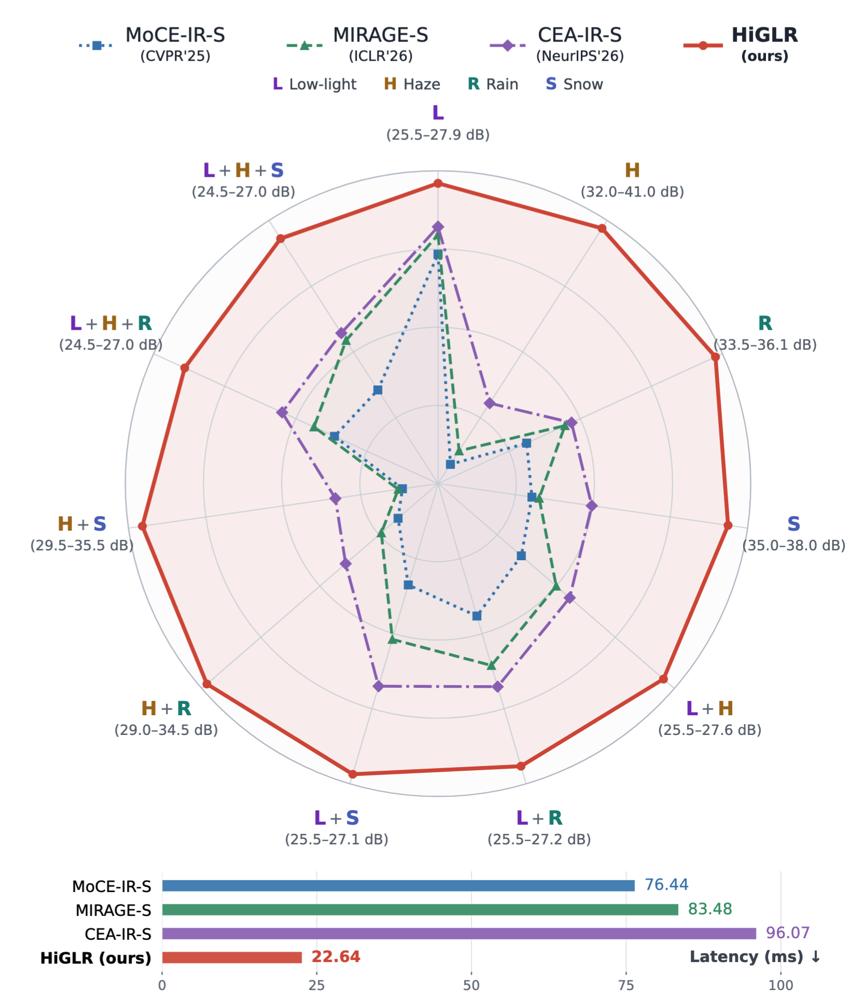
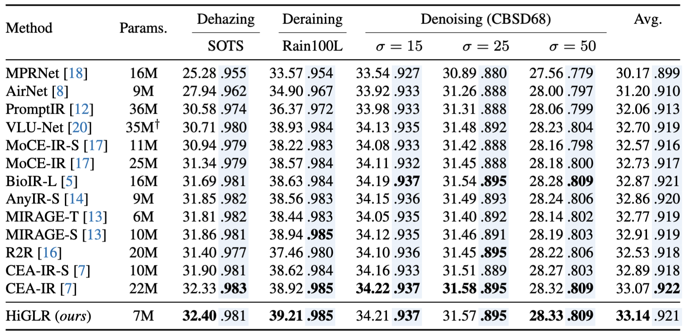
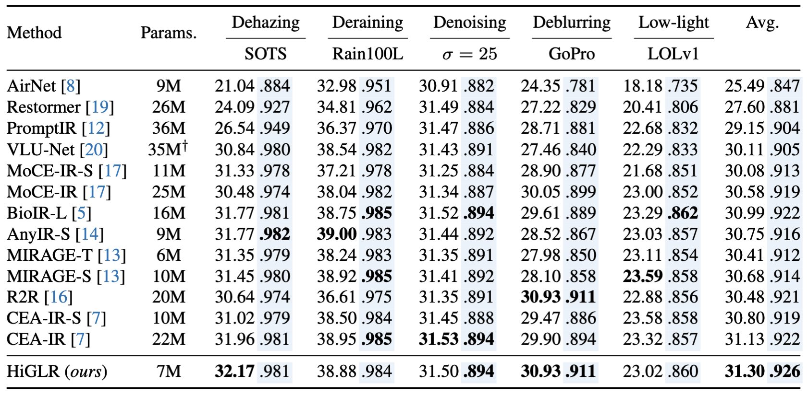
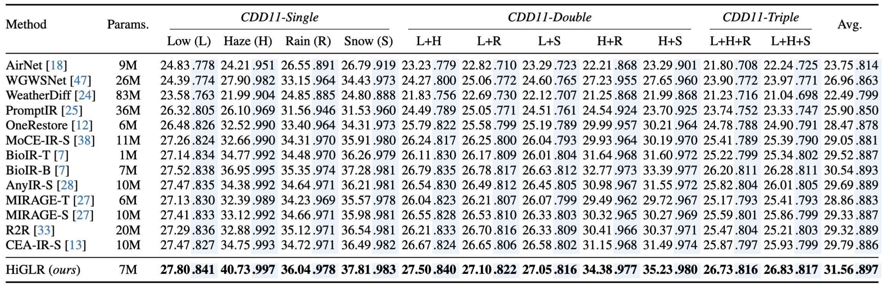

# What Is Redundant at High Resolution? Efficient Attention and Feed-Forward Design for All-in-One Image Restoration

This repository is the official implementation of **High-resolution Global-Local Restoration (HiGLR)**.

**Paper** · TODO | [Pre-trained Models](https://huggingface.co/collections/dslisleedh/higlr-6afe8ceef60900a77a8a4fde) | [CDD-11 Demo](https://huggingface.co/spaces/dslisleedh/HiGLR-CDD11)


[Download the interactive comparison](docs/comparison/slider.html?raw=true) and open it in a browser to move the divider.



## Abstract

> Multi-scale architectures are widely adopted in all-in-one image restoration (AIO-IR) to capture larger-scale context at low-resolution stages and refine details at high-resolution (HR) stages.
> However, processing spatially large feature maps at HR stages incurs substantial computational costs and memory traffic, making efficient HR processing challenging.
> To address this challenge, we propose High-resolution Global-Local Restoration (HiGLR), an efficient multi-scale AIO-IR network grounded in an analysis of spatial redundancy in self-attention and convolutional feed-forward networks (ConvFFNs).
> Specifically, this analysis identifies three key redundancies: per-query readout at the finest-scale stage, key routing across neighboring queries at intermediate stages, and spatial mixing in the expanded feature spaces of ConvFFNs.
> Accordingly, HiGLR replaces costly self-attention at the finest-scale stage with a learned input-independent kernel.
> At intermediate stages, we propose a Block-Routed Hybrid Attention, which combines coarse-scale dense attention with fine-scale block-sparse attention over value residuals relative to coarse summaries, and shares routing indices across neighboring queries.
> We further introduce a Dual-Space FFN that performs spatial mixing in a compact space and pointwise nonlinear transformation in an expanded space, enabling efficient kernel fusion.
> Combining these designs, HiGLR achieves state-of-the-art performance while delivering up to a 4.24× inference speedup over existing methods.

## Installation

From the repository root, install the dependencies in a Python 3.12 environment. The CUDA implementation uses PyTorch 2.14.0, torchvision 0.29.0 and Triton 3.8.0 with CUDA 12.6.

```bash
conda create -n higlr python=3.12
conda activate higlr
python -m pip install -r requirements.txt
```

## Training

Prepare the datasets using the [data guide](docs/DATA.md). The commands below use four GPUs with a global batch size of 32.

### AIO-3 and AIO-5

Pretrain on 128×128 patches, then fine-tune on 256×256 patches. For AIO-5, use `configs/aio5.json`, the AIO-5 training directory and a separate output directory for each stage.

```bash
torchrun --standalone --nproc-per-node=4 train.py \
  --config configs/aio3.json --stage pretrain \
  --data-root /path/to/AIO3/Train --output runs/aio3/pretrain --micro-batch 4

torchrun --standalone --nproc-per-node=4 train.py \
  --config configs/aio3.json --stage finetune \
  --data-root /path/to/AIO3/Train --output runs/aio3/finetune --micro-batch 4 \
  --init-checkpoint runs/aio3/pretrain/checkpoints/epoch_180.pt
```

### CDD-11

Train on 256×256 patches for 240 epochs with EMA.

```bash
torchrun --standalone --nproc-per-node=4 train.py \
  --config configs/cdd11.json --stage train \
  --data-root /path/to/CDD11 --output runs/cdd11/train --micro-batch 4
```

<details>
<summary>Training settings and checkpoints</summary>

| Setting | AIO-3 / AIO-5 pretrain | AIO-3 / AIO-5 fine-tune | CDD-11 |
|---|---:|---:|---:|
| Patch | 128² | 256² | 256² |
| Epochs | 180 | 40 | 240 |
| Warmup epochs | 15 | 7.5 | 15 |
| Global batch | 32 | 32 | 32 |
| FFT weight | 0.1 | 0.05 | 0.1 |
| EMA decay | 0.999 | 0.999 | 0.999 |

The trainer uses AdamW with β=(0.9, 0.9), weight decay 0.001 and a per-update schedule with linear warmup from 1e-6 to 1e-3 followed by cosine decay to 1e-6. Training combines L1, FFT-L1, MS-SSIM and classification losses.

The trainer saves `latest.pt` and `previous.pt` every epoch. It also keeps a checkpoint every 10 epochs during pretraining and CDD-11 training, every 5 fine-tuning epochs, and at the end of each stage. To resume an interrupted stage, repeat its command with `--resume /path/to/checkpoints/latest.pt` and the same source, configuration, data and GPU setup. Fine-tuning loads the pretrained model and EMA weights and starts a fresh optimizer and schedule.

</details>

## Testing

Restore one image with the EMA weights from a training checkpoint.

```bash
python inference.py --checkpoint runs/aio3/finetune/checkpoints/epoch_040.pt \
  --input input.png --output restored.png --weights ema
```

For a model-only `.pth` file, use `--weights raw`. For CPU inference, add `--device cpu --backend torch`.

<details>
<summary>Using HiGLR from Python</summary>

```python
import torch
from higlr import HiGLR

model = HiGLR(num_classes=3, backend="triton").cuda().eval()
model.load_state_dict(torch.load("HiGLR_AIO3.pth", map_location="cpu", weights_only=True))
with torch.inference_mode():
    restored = model(torch.rand(1, 3, 256, 256, device="cuda"))
```

Set `num_classes` to 3, 5 or 11 to match the checkpoint. Use FP32 model parameters and inputs. The Triton path handles BF16 attention internally on supported GPUs. The default BRHA inference backend recomputes routing scores. To store them instead, set `routing_backend="store"` or pass `--routing-backend store` to the image command. The model uses 8×8 blocks, with remote K32 during training and K16 during evaluation.

</details>

<details>
<summary>Run the tests</summary>

```bash
python -m pip install -r requirements-dev.txt
python -m pytest -q
```

</details>

## Results

### AIO-3



### AIO-5



### CDD-11



## Acknowledgement

We thank the authors of [R2R](https://github.com/cscxwang/R2R) for releasing their code.

## License

The original HiGLR code is distributed under the [MIT License](LICENSE). For the bundled R2R source, see [THIRD_PARTY.md](THIRD_PARTY.md).
